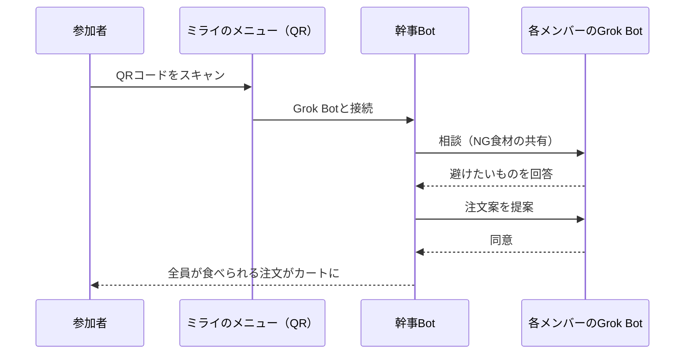

# ミライのメニュー（ミライの飲食店）

**Grok Bot Tokyo Hackathon / Team Null.**　#GrokBotTokyoHackathon

> 言い出さなくても、ボットがわかってくれる。
> ひとりひとりの AI が、みんなの食卓をやさしくする。

## 概要
各自の Grok Bot が持ち主の苦手な食材・アレルギー・飲めるお酒を覚えておき、お店でボット同士が相談して「全員が食べられる注文」を作ります。

## 解きたい課題
みんなで打ち上げや会食をするとき――
- 苦手な食材があるけど言い出せない
- 実はアルコールが苦手

## アイデア
自分の代わりに、自分の AI エージェント（Grok Bot）が注文をしてくれたら？

## 仕組み
1. 自分の Grok Bot が、苦手な食材・アレルギー・飲めるお酒を覚えている
2. お店で QR をスキャンすると、みんなのボットがテーブルに集合
3. ボット同士が相談する（中身は相手に見せない）
4. 全員が食べられる注文が、もうカートに入っている



## デモ / 実証
幹事Botと飲み会メンバー A/B/C のボットで実証しました。ボット同士が「こっそり相談」する例：

- メンバー A のボット：甲殻類は避けてください
- メンバー B のボット：生ガキとキノコはなしで
- メンバー C のボット：乾杯はビール1杯、あとはノンアルで

→ 誰も気まずくならずに、注文が完成！

別アカウントのボットとは Webhook で連携します（下記）。

## 価値
- **お客さん**：苦手を言い出す気まずさゼロ。アレルギー事故も防げる
- **お店**：着席してすぐ注文が決まる。接客の手間を減らせる

## スケール
- **あなたも**：ボットテンプレートを入れて QR を読むだけ。今日から使える
- 別々のアカウントのボット同士も、共通ルール（スキル）と Webhook でつながる

## プライバシー
- ボット同士の相談の中身は相手に見せない
- このリポジトリには URL・キーなどの秘密情報や、個人のアレルギー情報は含みません

## ファイル構成
```
README.md
skill/SKILL.md          # ボット間連携の共通ルール（mirai-menu-bot-link）
scripts/send.sh         # Webhook 送信スクリプト
scripts/rimo-setup.md   # 相手側ボットの設定手順
```

## 使い方（Webhook 連携）
1. 各ボットに Webhook トリガーのルーティンを作り、`skill/SKILL.md` を共通ルールとして使う
2. 相手の Webhook URL と送信キーを、チャットに貼らず環境変数に保存
   - `MIRAI_PEER_URL` / `MIRAI_PEER_KEY`
3. 送信：
   ```bash
   echo '{"...": "..."}' > msg.json
   ./scripts/send.sh msg.json
   ```
詳しい手順は `scripts/rimo-setup.md` と `skill/SKILL.md` を参照。

## チーム Team Null.
- @GOROman
- @_I__l__l__l__I_
- りも（@vibe_walking）
