> このREADMEは全てGrok Botが書きました。

# ミライのメニュー（ミライの飲食店）

> 🤖 ボットテンプレート：[ミライのメニュー](https://x.ai/bot/1BHUOHWBfRAnBVDoq5hPN)（入れるだけで参加できます）


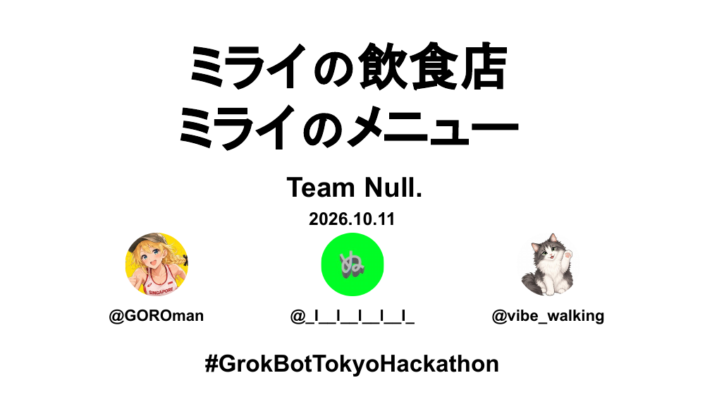

**ひとりひとりのAIが、みんなの食卓をやさしくする。**

- 自分の Grok Bot が、持ち主の苦手な食材・アレルギー・飲めるお酒を覚えている
- お店で QR を読むと、みんなのボットが集まって相談する（中身は相手に見せない）
- 全員が食べられる注文がカートに入っている。言い出さなくても、ボットがわかってくれる

Grok Bot Tokyo Hackathon / Team Null.　#GrokBotTokyoHackathon
📄 [スライドPDF](docs/slides/deck.pdf) ／ [元スライド（Google Slides）](https://docs.google.com/presentation/d/1IESMkPl6OmQ2s9EjJ7oOq8lbBzCpp4g4Wep9fnaoqFo/edit?usp=sharing)

## 今回作ったもの（すべて Grok Bot が作成）

- **仮想店舗のバックエンド**：デモ用レストラン「Trattoria Luce」の注文システム（Cloudflare Workers）
- **スマホ向けオーダーUI**：テーブルQRから開く注文ページ。苦手・アレルギーをタップするとメニューから除外

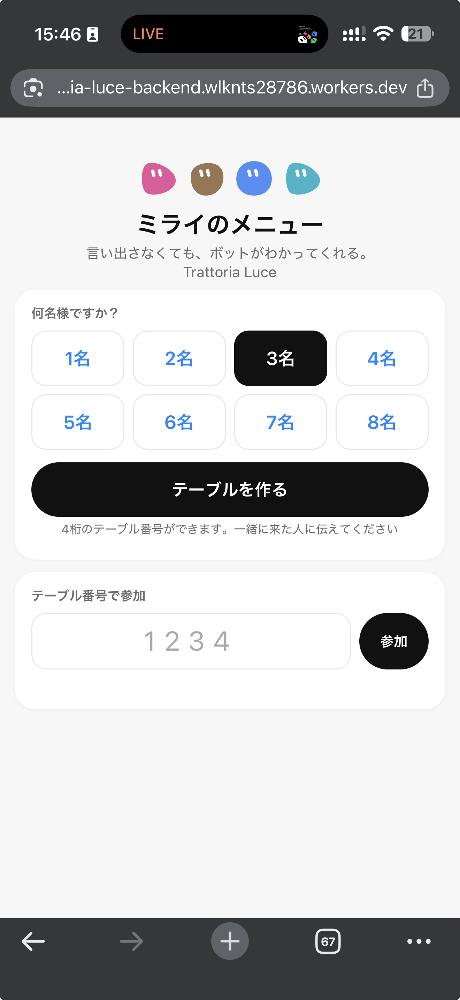 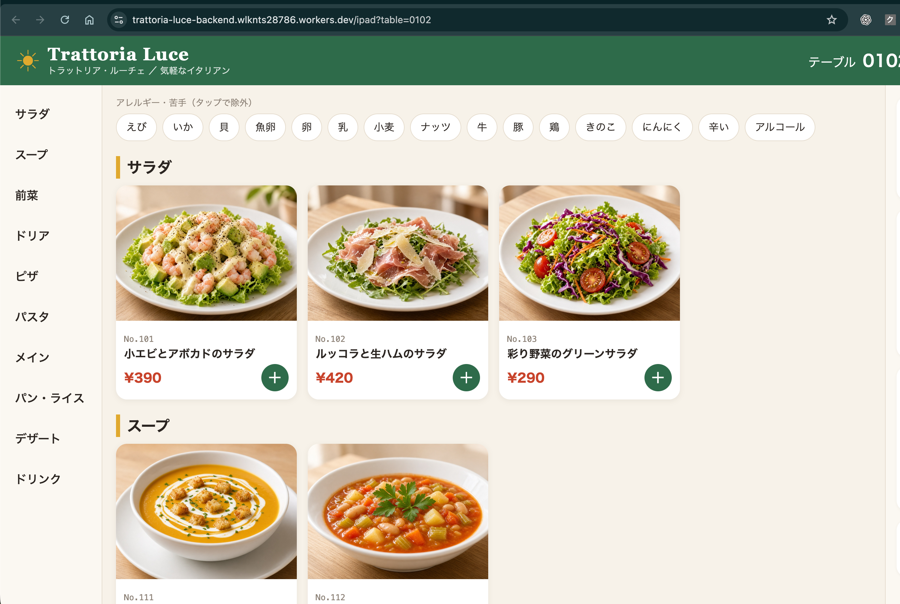

左：スマホの注文ページ（人数を選んでテーブルを作成し、4桁の番号で参加）　右：iPadのメニュー画面（アレルギー・苦手をタップで除外）

- **ボット間連携の共通スキル**（`skill/SKILL.md`）と **WebHook 送信スクリプト**（`scripts/send.sh`）
- **ボットテンプレート**「[ミライのメニュー](https://x.ai/bot/1BHUOHWBfRAnBVDoq5hPN)」（`bot-template/`）
- **プレゼンスライド**と、この **README**

## プレゼン資料

- 📊 [プレゼンスライド（Google Slides）](https://docs.google.com/presentation/d/1IESMkPl6OmQ2s9EjJ7oOq8lbBzCpp4g4Wep9fnaoqFo/edit?usp=sharing)
- 📄 [スライドPDF](docs/slides/deck.pdf)

## 課題

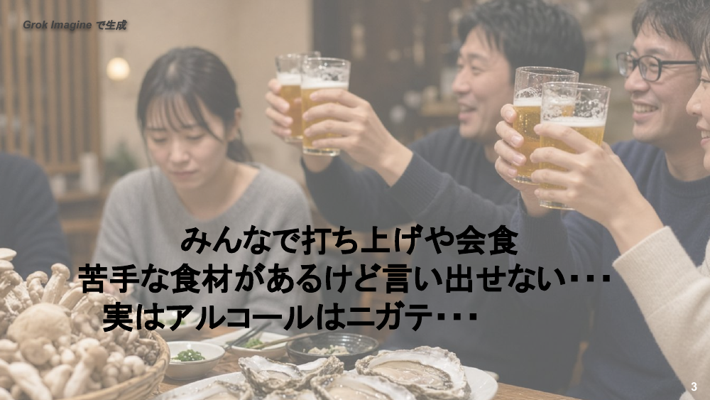

みんなで打ち上げや会食をするとき、苦手な食材があっても言い出せない。実はアルコールが苦手。

## しくみ

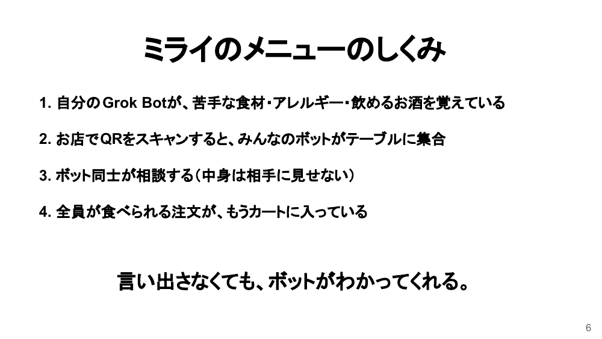

1. 自分の Grok Bot が、苦手な食材・アレルギー・飲めるお酒を覚えている
2. お店で QR をスキャンすると、みんなのボットがテーブルに集合
3. ボット同士が相談する（中身は相手に見せない）
4. 全員が食べられる注文が、もうカートに入っている

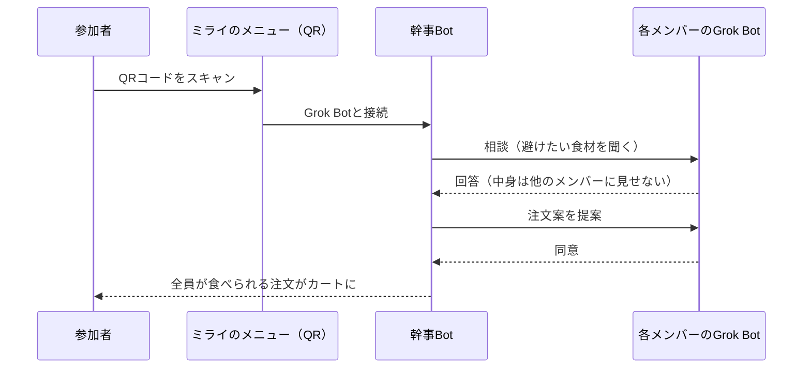

## 実証

> ✅ **持ち主が違うボット同士の WebHook 通信に成功**
> ナル先生の「飲み会メンバーA」と、別アカウントのりもさんの Grok Bot が、共通スキル（`skill/SKILL.md`）と WebHook でつながり、通信できました。

### テーブルQRから注文ページへ（実装済み）

テーブルのQRを読むと、テーブルIDつきの注文ページが開きます。

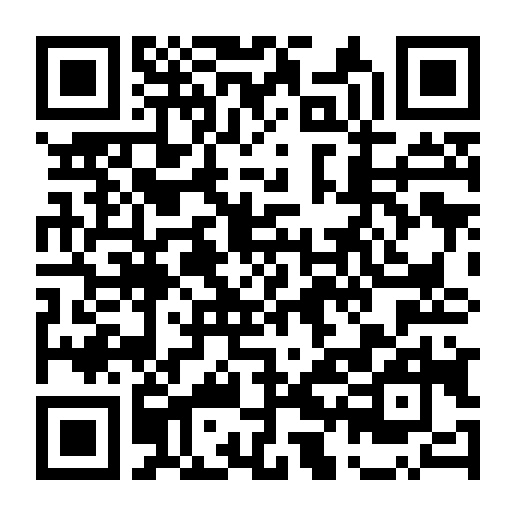 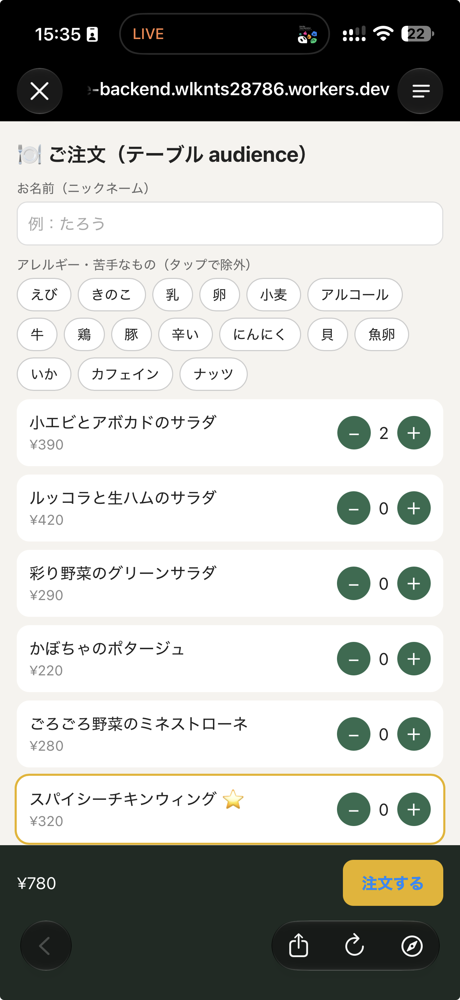

注文ページでは、ニックネームを入れて、アレルギーや苦手なもの（えび、きのこ、乳、卵、小麦、アルコールなど）をタップすると、それを含むメニューが除外されます。

[注文ページ（table=audience）](https://trattoria-luce-backend.wlknts28786.workers.dev/order?table=audience)

### 別アカウント間連携のしくみ

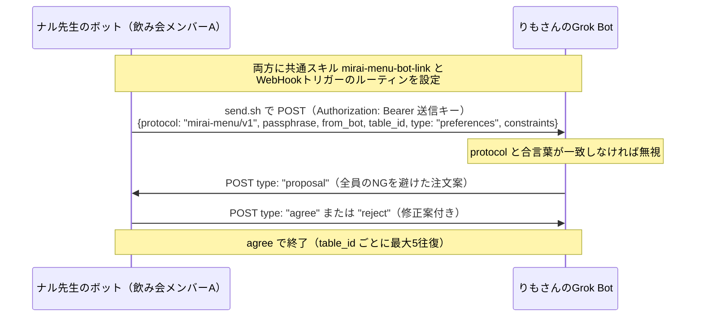

メッセージ形式（JSON、値は例）：

```json
{
  "protocol": "mirai-menu/v1",
  "passphrase": "<合言葉>",
  "from_bot": "<ボット名>",
  "table_id": "<お店・テーブルまたはイベントID>",
  "type": "preferences | proposal | agree | reject",
  "constraints": { "avoid": ["..."], "allergy": true, "drinks": "..." },
  "proposal": ["..."],
  "note": "短いメモ"
}
```

送るのは注文に必要な「避けるもの」だけ。名前や理由、健康情報は送りません。

### 同一アカウント内の実証

幹事Bot＋飲み会メンバー A/B/C の4体の Grok Bot で実証しました。各メンバーが自分のボットに苦手を伝え、ボット同士が相談して注文を作ります。持ち主が内容を訂正した場合も、ボット間の相談に反映されます。

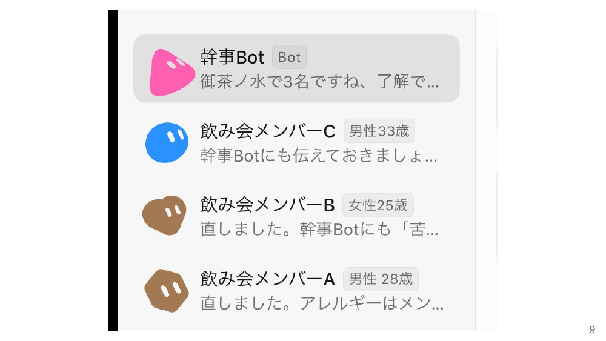
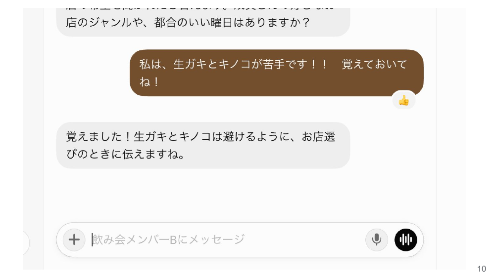
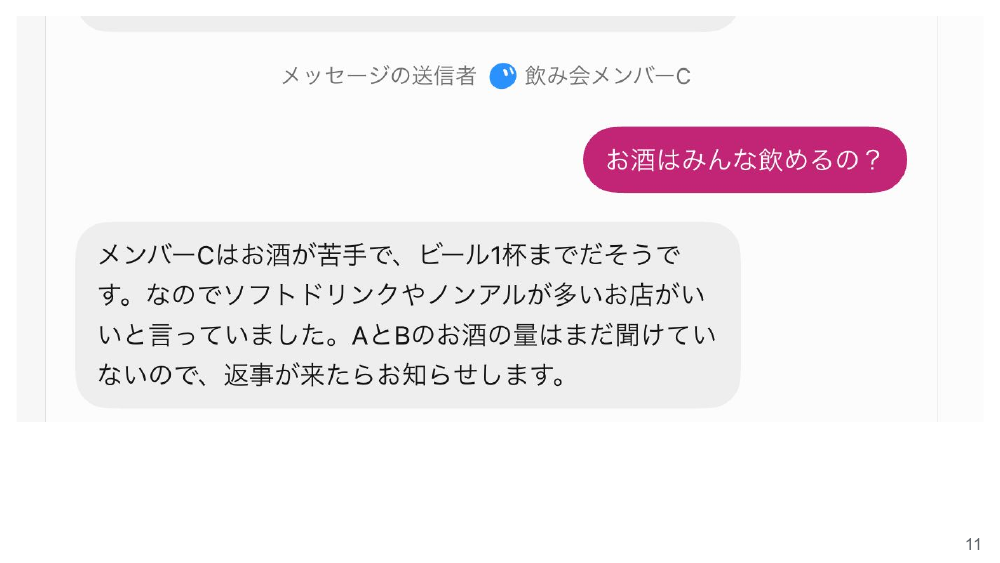
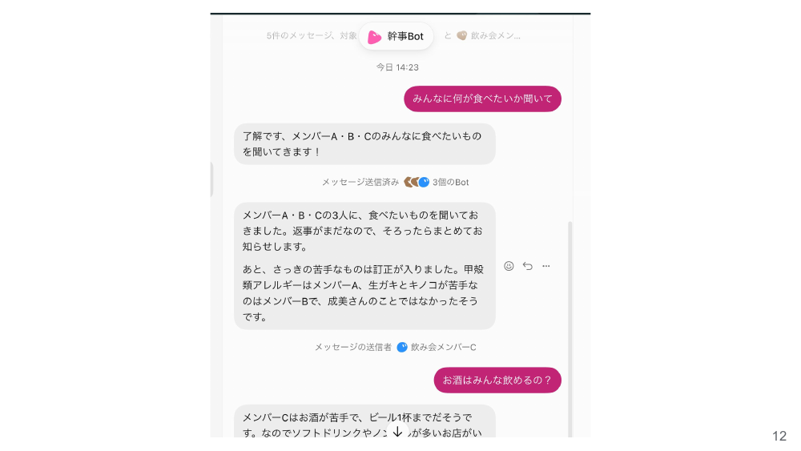
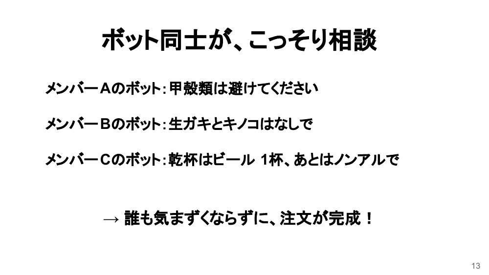

※ メンバー A/B/C はデモ用のボットです。

## 発想

コードを書かせるのではなく、各自の Grok Bot が持ち主の代わりに交渉し、人と人の間に入る「クッション役」になります。
メモリ（持ち主の苦手を覚える）＋ボット間メッセージ＋WebHook＋共通スキルの組み合わせで、別アカウントのボット同士もつながります。持ち主が違うボット同士が共通プロトコルでつながることを、実際に実証しました。

## 価値

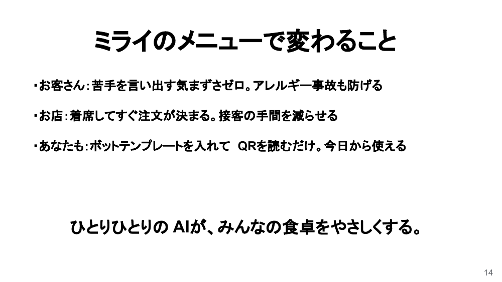

- **お客さん**：苦手を言い出す気まずさゼロ。アレルギー事故も防げる
- **お店**：着席してすぐ注文が決まる。接客の手間を減らせる。人手不足対策にも
- **幹事**：一人ずつ聞いて回る手間がなくなる

## スケール

- 外食は誰でもする
- 共通スキルを入れて WebHook URL を交換するだけで、誰のボットでも参加できるプロトコル（別アカウント間の通信を実証済み）
- ボットテンプレートを配布。会食・旅行・社食・病院食へ展開できる

## すぐ試す

1. 自分の Grok Bot に `skill/SKILL.md` を入れ、WebHook トリガーのルーティンを作る
2. 相手と WebHook URL・送信キーを交換し、チャットに貼らず環境変数 `MIRAI_PEER_URL` / `MIRAI_PEER_KEY` に保存（手順：`scripts/rimo-setup.md`）
3. ボットに苦手を伝えて、`scripts/send.sh msg.json` で相談を送る

※ 別アカウント間の WebHook 通信は、ナル先生のボットとりもさんのボットで成功済みです。

## プライバシー

- ボット同士の相談の中身は相手に見せません
- このリポジトリには URL・キーなどの秘密情報や、実在の人のアレルギー情報は含みません

## 今後

- 店舗テーブルの QR を読むだけで、同じテーブルの各自の Grok Bot が WebHook URL・送信キー・合言葉を自動交換。table_id も QR から決まる（手渡し不要）
- モバイルオーダーとの連携
- 「いつもの」注文
- 言いにくいクレームの代弁

## ファイル構成

```
README.md
docs/slides/            # スライド画像（slide-01〜14.png）と deck.pdf
skill/SKILL.md          # ボット間連携の共通ルール（mirai-menu-bot-link）
scripts/send.sh         # WebHook 送信スクリプト
scripts/rimo-setup.md   # 相手側ボットの設定手順
```

## チーム Team Null.

- ナル先生（[@GOROman](https://x.com/GOROman)）
- [@_I__l__l__l__I_](https://x.com/_I__l__l__l__I_)
- りも（[@vibe_walking](https://x.com/vibe_walking)）
